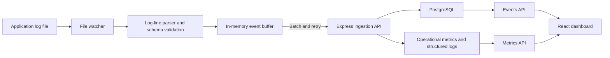

# SIEM-Obs

A lightweight security event collection and observability platform built with **TypeScript, Node.js, Express, PostgreSQL, React, and Vite**. SIEM-Obs watches a newline-delimited application log, parses new entries into structured events, batches them for ingestion, stores events in PostgreSQL, and presents searchable events and operational metrics in a web dashboard.

> **Project scope:** SIEM-Obs is a portfolio and learning project, not a production-certified SIEM. See [Security and production considerations](#security-and-production-considerations) before exposing it outside a trusted development environment.

## Features

- **Log collection:** watches a configured local log file and parses appended lines into structured events.
- **Buffered batch ingestion:** groups events by batch size or flush interval, retries failed sends with exponential backoff, and tracks retries and flush failures.
- **PostgreSQL persistence:** stores event timestamps, severity levels, sources, messages, and JSON metadata.
- **Event search:** filter events by severity, source, and time range, with cursor-based pagination.
- **Event details:** inspect the fields and metadata of individual events.
- **Live operational dashboard:** view collector counters, HTTP request counts/status totals, and request-duration totals; the metrics view refreshes periodically.
- **API protection:** API-key authentication, browser login sessions, and rate limiting for event and metrics routes.
- **Operational visibility:** structured logs, request IDs, request-duration tracking, health/liveness endpoints, and graceful server/database shutdown handling.
- **Validation and testing:** Zod request/event schemas, parameterised SQL, Vitest tests, TypeScript checks, frontend linting, and a batch-ingestion benchmark script.

## Architecture



### Main components

- `src/collector/` — file watching, parsing, buffering, retry logic, API client, and collector statistics.
- `src/server.ts` — Express routes for events, batch ingestion, metrics, health, liveness, and browser authentication.
- `src/database.ts` and `db/init.sql` — PostgreSQL connection pool and event-table schema.
- `src/middleware/` — API-key/session authentication, rate limiting, request IDs, and HTTP request logging.
- `src/metrics.ts` — in-process operational counters.
- `frontend/` — React dashboard, event search/details, and metrics views.
- `scripts/benchmark-ingestion.ts` — a small script for exercising batch sizes of 1, 10, 100, and 1,000 events.

## Requirements

- Node.js and npm versions compatible with the project's installed TypeScript, Vite, and ESLint toolchain.
- Docker Desktop (or Docker Engine with the Compose plugin) for local PostgreSQL.
- PowerShell commands below are written for Windows; equivalent shell commands can be used on other platforms.

## Run locally

### 1. Install dependencies

From the repository root:

```powershell
npm install
npm --prefix frontend install
```

### 2. Configure environment variables

Create a local `.env` file from the example:

```powershell
Copy-Item .env.example .env
```

Edit `.env` and set the following values for the included local Docker Compose database:

```dotenv
API_URL=http://localhost:3000
LOG_FILE_PATH=logs/collector.log
BATCH_SIZE=100
FLUSH_INTERVAL_MS=5000
MAX_RETRIES=5
PORT=3000
DB_HOST=localhost
DB_PORT=5432
DB_USER=siem
DB_PASSWORD=siem_dev_password
DB_NAME=siem
API_KEY=replace-with-a-long-random-local-secret
RATE_LIMIT_MAX=100
RATE_LIMIT_WINDOW_MS=60000
```

`DB_PASSWORD` must match the password configured by `docker-compose.yml` for a fresh local database volume. Choose a non-default `API_KEY` for your local environment; the API and collector read the same key. Do not commit `.env` or put real secrets into screenshots or source control. `.env` is ignored by Git.

Create the log directory and file. The collector watches the directory containing the configured file, so the directory must exist before the backend starts:

```powershell
New-Item -ItemType Directory -Force logs | Out-Null
if (-not (Test-Path .\logs\collector.log)) {
    New-Item -ItemType File -Path .\logs\collector.log | Out-Null
}
```

### 3. Start PostgreSQL

```powershell
docker compose up -d postgres
docker compose ps
```

The Compose configuration exposes PostgreSQL on `localhost:5432` and initialises the `events` table from `db/init.sql` when the database volume is first created. If the database does not become ready immediately, check `docker compose logs postgres` before starting the API.

### 4. Start the backend and collector

In a terminal at the repository root:

```powershell
npm run dev
```

This starts the Express API and the file collector. The API listens on port `3000` by default.

### 5. Start the frontend

Open a second terminal at the repository root:

```powershell
npm --prefix frontend run dev
```

Open the local URL printed by Vite (normally `http://localhost:5173`). Sign in using the `API_KEY` value from your local `.env` file. The Vite development server proxies `/api` requests to `http://localhost:3000`.

### 6. Generate a test event

The collector starts watching from the current end of the file; existing lines are not replayed on startup. Append a new line after the backend is running:

```powershell
$timestamp = [DateTime]::UtcNow.ToString("yyyy-MM-ddTHH:mm:ss'Z'")
Add-Content -Path .\logs\collector.log -Value "$timestamp INFO demo Test event from the local collector"
```

The expected line format is:

```text
<TIMESTAMP> <LEVEL> <SOURCE> <MESSAGE>
```

Supported levels are `DEBUG`, `INFO`, `WARN`, `ERROR`, and `CRITICAL`. The message is the remainder of the line after the first three fields. Lines are processed after their newline is received. Check the Events view in the dashboard for the new `demo` event.

You can also query the database directly:

```powershell
docker compose exec postgres psql -U siem -d siem -c "SELECT timestamp, level, source, message FROM events ORDER BY timestamp DESC LIMIT 10;"
```

## API overview

The event and metrics routes accept either a valid browser session cookie or a bearer API key, except where indicated below.

| Method | Endpoint | Purpose | Authentication |
|---|---|---|---|
| `GET` | `/` | Basic API status | None |
| `GET` | `/api/live` | Liveness check | None |
| `GET` | `/api/health` | Database connectivity check | None |
| `POST` | `/api/auth/login` | Exchange the API key for a browser session cookie | API key in request body |
| `GET` | `/api/auth/me` | Check the current browser session | Session cookie |
| `POST` | `/api/auth/logout` | End the current browser session | Session cookie, if present |
| `GET` | `/api/events` | Search events, with filters and cursor pagination | Required |
| `POST` | `/api/events` | Insert a single event | Required |
| `POST` | `/api/events/batch` | Insert a batch of events in a transaction | Required |
| `GET` | `/api/metrics` | Read in-process operational metrics | Required |

### Event query parameters

`GET /api/events` supports:

- `level` — event severity, such as `ERROR`.
- `source` — exact source value.
- `from` and `to` — ISO date-time range bounds.
- `limit` — page size from 1 to 100 (default: 50).
- `before` — opaque cursor returned by the previous response for the next page.

Example using a bearer API key in PowerShell:

```powershell
$headers = @{ Authorization = "Bearer $env:API_KEY" }
Invoke-RestMethod -Uri "http://localhost:3000/api/events?level=ERROR&limit=25" -Headers $headers
```

Set `$env:API_KEY` in that PowerShell session before running the example, or use your local key without committing it to a script. The frontend signs in through `/api/auth/login` and subsequently uses its session cookie.

### Batch-ingestion body

`POST /api/events/batch` expects an `events` array. Each event includes `timestamp`, `level`, `source`, `message`, and optional `metadata`. The schema permits 1–1,000 events per batch.

```json
{
  "events": [
    {
      "timestamp": "2026-10-16T13:00:00.000Z",
      "level": "WARN",
      "source": "demo-service",
      "message": "Example event accepted by the collector",
      "metadata": {
        "environment": "local"
      }
    }
  ]
}
```

## Configuration reference

| Variable | Purpose | Example/default in `.env.example` |
|---|---|---|
| `API_URL` | Base URL used by the collector to call the API | `http://localhost:3000` |
| `LOG_FILE_PATH` | Log file watched by the collector | `logs/collector.log` |
| `BATCH_SIZE` | Event count that triggers a buffer flush | `100` |
| `FLUSH_INTERVAL_MS` | Maximum interval between flush attempts | `5000` |
| `MAX_RETRIES` | Number of retries after an initial failed send | `5` |
| `PORT` | Express listen port | `3000` |
| `DB_HOST` | PostgreSQL hostname | `localhost` |
| `DB_PORT` | PostgreSQL port | `5432` |
| `DB_USER` | Database user | `siem` |
| `DB_PASSWORD` | Database password | Set to match the local Compose configuration |
| `DB_NAME` | Database name | `siem` |
| `API_KEY` | Shared key for API authentication and collector ingestion | Set locally; do not use a committed example value |
| `RATE_LIMIT_MAX` | Requests permitted per rate-limit window | `100` |
| `RATE_LIMIT_WINDOW_MS` | Rate-limit window in milliseconds | `60000` |

## Tests, builds, and lint

Run these from the repository root:

```powershell
npm test
npm run typecheck
npx tsc --project scripts/tsconfig.json
npm run build
npm --prefix frontend run lint
npm --prefix frontend run build
```

The backend tests use Vitest and cover the collector, event parsing/buffering/retries, database interactions, request validation, authentication, rate limiting, API routes, metrics, logging, and shutdown behavior.

## Batch-ingestion benchmark

With PostgreSQL and the backend running, and `API_KEY` set in the environment used by the script, run:

```powershell
npx tsx scripts/benchmark-ingestion.ts
```

The script exercises batch sizes of 1, 10, 100, and 1,000 events. It reports request duration, HTTP status, result, and calculated events per second. Run it against a local test database; it inserts benchmark records into the `events` table. Results vary by machine, database state, and runtime, so report measured values together with the environment and successful HTTP status. Do not compare runs where ingestion requests were rejected.

## Security and production considerations

This project demonstrates several security and reliability practices, but it should be treated as a local portfolio application until the following areas are reviewed for a production deployment:

- The supplied Docker Compose credentials are development defaults. Change them for any shared environment and manage secrets outside source control.
- Browser sessions and operational metric counters are held in process memory. Sessions and counters reset on backend restart, and sessions are not shared across multiple server instances.
- The current cookie configuration is intended for local development (`secure: false`). A deployment served over HTTPS should use secure cookie settings and appropriate deployment-specific session controls.
- The rate limiter is in process memory; multi-instance deployments need a shared rate-limit store and careful proxy/IP configuration.
- Deploy behind HTTPS, use appropriately scoped credentials, set sensible network access controls, and review request/body limits, logging, backup, retention, and monitoring policies before handling real data.
- The system collects and stores log messages and JSON metadata. Avoid sending real secrets, access tokens, or sensitive personal data in test events.

## Technology stack

- **Backend:** Node.js, TypeScript, Express
- **Database:** PostgreSQL, `pg`
- **Validation:** Zod
- **Collector:** Node.js file watching, batching, retry with exponential backoff
- **Frontend:** React, TypeScript, Vite
- **Testing and quality:** Vitest, Supertest, TypeScript, ESLint
- **Local environment:** Docker Compose

## License

The package metadata currently declares the ISC license. Ensure a matching `LICENSE` file is committed so the licensing terms are clearly available to people viewing the repository. Contact the repository owner if you are unsure whether reuse is permitted.
